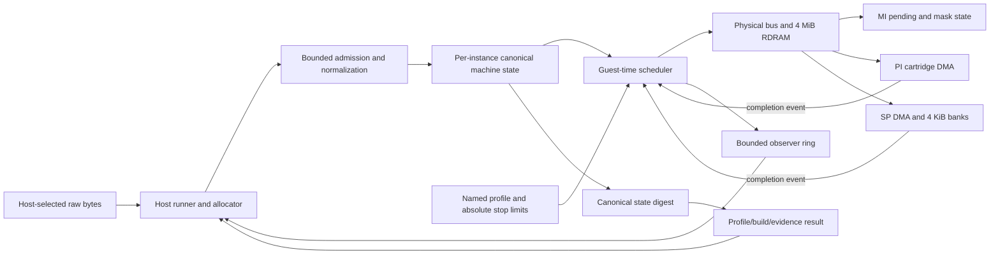

# Phase 2: Deterministic Machine Skeleton - Research

**Researched:** 2026-11-10  
**Domain:** C17 deterministic machine core, guest-time scheduling, physical bus, DMA, ROM admission  
**Confidence:** MEDIUM

<user_constraints>
## User Constraints (from CONTEXT.md)

### Locked Decisions

### Instance and content ownership
- **D-01:** Keep C17/CMake/Ninja/CTest and the provisional opaque-instance API.
  The host supplies allocation/release callbacks; the core owns each allocated
  machine and admitted canonical image until destruction/replacement. Callbacks
  run only during lifecycle/admission, never scheduled device execution. No
  per-access host memory callbacks, mutable globals, host clocks/files or threads.
  Caller spans are readable and stable during admission; reject overlap with
  instance-owned storage. Each instance has disjoint writable RAM and metadata.
- **D-02:** Admission validates and builds a private candidate, normalizes bytes,
  hashes content and commits once complete; allocation failure and every other
  refusal preserve the prior machine digest and observable state. Release the
  old image only after success. Successful replacement resets guest state by an
  explicit documented rule. No fixed 128 MiB dual-ROM arena is required.

### Profiles and identity
- **D-03:** Define a named first NTSC/cartridge/4 MiB/open-IPL3-route skeleton
  profile with explicit console target, timing tier/model versions, integer tick
  unit, CPU:RSP synchronization quantum and scheduler-order version. The route
  identifies intended boot ownership, not implemented boot. Hash a versioned
  canonical descriptor containing every behavior-affecting value. Build identity
  is separate, has no timestamps/private paths, and is absent from state digest.
  Every skeleton test result reports profile ID/hash, build identity and its
  honest evidence tier. Preserve the Phase 1 synthetic runner's identity.
- **D-04:** Header country metadata never selects TV type/region. Test identical
  content under two explicit profile descriptors; the second is a test-only
  contrast and is not a PAL support claim. Document unsupported/deferred/unknown
  behavior and the evidence that would promote it.

### Scheduling and observations
- **D-05:** Per-instance bounded queue ordered by `(tick, enqueue_sequence)`.
  Equal-tick FIFO is project policy, not bus arbitration evidence. No past events,
  silent drops, arithmetic wrap or unbounded zero-time loops. Reject impossible
  scheduling before mutation. Reserve completion capacity before accepting DMA.
  Queue/sequence exhaustion has an explicit tested postcondition.
- **D-06:** Absolute guest-time bounds are inclusive: dispatch all events through
  the bound and stop at exactly that tick, including idle time. Instruction/frame
  bounds stop immediately at their cumulative counter event; no remaining event
  is dispatched beyond that counter bound. A lower-than-current bound refuses
  unchanged; equal/current and halt-at-bound precedence must be explicit. An
  impossible counter bound reports quiescence without falsely claiming success.
  Test one-shot vs partitioned advancement and isolated vs interleaved instances.
- **D-07:** Canonical versioned state serialization hashes fixed-width explicit
  endian fields, profile/content identities, counters, RAM, registers and queued
  request metadata in logical order. Hash no padding, pointers, build identity,
  unused queue slots or trace configuration. Audit every future-affecting field.
  Reuse one authored SHA-256 implementation inside the linted core boundary.
- **D-08:** Trace device-boundary copies into a bounded per-instance observer
  ring; drain outside advancement. Overflow is visible as an observer drop count
  and cannot block or change machine execution. Trace-on/off and overflow runs
  must finish with the same state digest. No host sink calls inside handlers.

### Physical bus and DMA evidence
- **D-09:** Use the physical map, MI encodings and SP fields in DECISION-B with
  their source locators and pins. Bounds-check 4 MiB RDRAM and 4 KiB SP banks;
  explicit unsupported/unmapped results do not alias RAM. MI pending and masks
  are separate; mask writes never acknowledge pending. Paired mask commands use
  documented set-wins policy. No SP interrupt from DMA completion alone.
- **D-10:** PI/SP DMA stages an immutable descriptor and transfers bytes only at
  scheduled completion, not request time. Read source bytes at completion under
  this named atomic-transfer model; do not imply progressive hardware visibility.
  SP has active+pending slots, rounded 8-byte line lengths/count/skip, selected
  bank wrap, and explicit full-queue behavior. PI permits one active transfer,
  validates the whole ROM/RAM range, sets PI pending on completion, and handles
  reset/cancellation without stale writes or duplicate completion. Specify register
  latch/readback, queue promotion, same-tick order, busy/error/IRQ and invalid
  request postconditions in the executable contract.
- **D-11:** Unknown PI duration/arbitration and SP edge semantics stay named
  profile policies: candidate PI duration `1 + N/2` model ticks; SP duration
  `12 + payload/8` RSP cycles with an explicit integer tick conversion. Validate
  these against the sources and preserve lower evidence labels. PI `N-1`, SP
  bank-wrap/full-queue, and simultaneous MI clear/set are documented inferences
  or model choices where primary evidence is incomplete. No cycle-accuracy claim.
  Native expectations cite a source or policy version, independently derive
  exact bytes/deadlines, and cover boundary, overlap, queue-full and cancellation.

### Admission safety and verification
- **D-12:** Admit raw spans only, initially 4096..67108864 bytes, word aligned in
  length, with one of the three known dump-order signatures. Normalize to big
  endian. Parse a fixed 64-byte header using explicit bounded byte loads. Retain
  raw fixed-width title/game-code/version metadata; unknown metadata is allowed.
  Reject null/short/oversized/non-word/unknown-order input before commit; never
  unpack archives or infer profile, save device, rights or CIC from a title.
- **D-13:** Fuzz the production admission/parser/normalization code under ASan
  and UBSan, using authored runtime-generated bytes, every short-prefix and
  field boundary and all three valid byte orders. Use a pinned seed and bounded
  deterministic campaign, record reached branches/fields plus case inventory,
  and prove sanitizers catch a seeded fault in a separate control. Test real
  admission atomicity and allocator denial, not just a four-byte stub. No clean
  campaign is proof of memory safety; do not reinterpret the Phase 1 language
  experiment or silently broaden its registered switching criteria.
- **D-14:** Extend the existing gate with focused CTest component and seam
  evidence; keep one public gate command and the existing two hosted lanes. Run
  sanitizer evidence locally with the existing asan preset; add recurring CI cost
  only for a demonstrated distinct failure class. Inspect CI critical path after
  any push, retain exact tested source identity, run independent code
  review/security/goal verification and fix findings before phase completion.

### The agent's Discretion
Exact provisional function/file names, bounded queue capacity, trace record
shape, canonical binary encoding, allocation alignment mechanism and test
organization are implementation choices. Keep plans small enough for independent
execution, with dependency order and shared-file ownership explicit. Resolve
routine reversibility and evidence choices without additional owner prompts.

### Deferred Ideas (OUT OF SCOPE)
CPU/RSP instructions, boot/IPL3 selection, real VI/audio, arbitration and
cycle-exact timing, state export/replay and ABI freeze remain in their roadmap
phases. Rights decisions, releases/versioning, branding, copy-allowlist expansion
and physical hardware stay under existing owner stops. Branch protection and
the narrow public-history scanner waiver are unchanged repository-policy items.
</user_constraints>

## Project Constraints (from AGENTS.md)

- Preserve the Tendies64 working name; do not infer trademark clearance. Keep
  the long-term emulator goal ambitious while making the first profile small and
  independently verifiable. [VERIFIED: AGENTS.md:1-30]
- Keep one canonical deterministic machine implementation separate from host
  clocks, file access, physical input, presentation and durable storage. Define
  ownership, lifecycle and refused-operation effects before freezing an API/ABI.
  [VERIFIED: AGENTS.md:15-24]
- Keep device boundaries observable and separate guest progress/time, raw video,
  raw audio and host presentation. [VERIFIED: AGENTS.md:22-25]
- Prefer a small dependency tree; copied code needs clear provenance and a
  maintenance owner. Treat ROM, boot, save and archive inputs as rights-bearing
  or untrusted; do not put uncleared material in source control or public CI.
  [VERIFIED: AGENTS.md:25-31]
- Tie every support claim to an exact profile/build/evidence tier. Determinism,
  a boot, screenshot, score or comparison does not establish broad compatibility
  or hardware accuracy. [VERIFIED: AGENTS.md:31-36]
- Follow the autonomous GSD policy and preserve its rights, authority, physical,
  publication and destructive-action stops. Routine reversible implementation
  choices proceed under the accepted workflow. [VERIFIED: AGENTS.md:37-58;
  .planning/AUTONOMY.md:1-64]

<phase_requirements>
## Phase Requirements

| ID | Description | Research Support |
|----|-------------|------------------|
| PROF-01 | “User can select a named machine profile that fixes console revision, TV type, RAM size, boot route, expansion and peripheral set, and the first profile is NTSC, cartridge-only, 4 MB RDRAM with an open IPL3 boot route” | Model the profile identity and its limitations; explicitly label the open-IPL3 route as target intent, not boot support. |
| PROF-02 | “User can see the profile identity, and the build identity, recorded in every result” | Preserve the result protocol and emit profile ID/hash, build identity and evidence tier on every Phase 2 result. |
| PROF-03 | “User can see TV type and region come from the profile and never inferred from the ROM header country byte” | Add a two-descriptor test that varies header country metadata without changing selected profile behavior. |
| PROF-04 | “User can see unsupported, deferred and unknown profile features documented, with the evidence that would promote each” | Create profile-limits documentation that distinguishes source facts, model policy and missing hardware evidence. |
| PROF-06 | “Maintainer can see two interleaved instances in one process produce digests equal to isolated runs” | Use disjoint instance allocations and compare each interleaved final digest with isolated runs. |
| CORE-01 | “The core advances in guest time using a single-threaded event queue with a total order, and the host never drives guest time” | Use a bounded per-instance queue ordered by tick then insertion sequence; no host clock or slice-dependent results. |
| CORE-02 | “Device activity (CPU, RSP, RDP, VI, AI, PI, SI, MI) is ordered by the scheduler, with the CPU-to-RSP synchronization quantum recorded in the profile identity” | Phase 2 wires only the present skeleton devices and records the CPU:RSP quantum; it does not claim CPU or other device execution. |
| CORE-03 | “The core runs for a bounded stop condition (guest time, instruction count or frame event) and reports why it stopped” | Define inclusive guest-time, cumulative synthetic instruction/frame counters, halt, refusal and quiescent outcomes. |
| CORE-06 | “Maintainer can inspect guest-time-stamped trace events at device boundaries without changing results” | Bounded observer ring, visible drops, drain outside advance, equal traced/untraced state digest. |
| BUS-01 | “The core implements the memory map, 4 MB RDRAM, cartridge ROM access through PI and the MI interrupt registers, with masked-versus-pending interrupt behavior per the references” | Physical ranges, no alias to installed RAM, PI cartridge reads, and separate pending/mask behavior with source-tier labels. |
| BUS-02 | “PI and SP DMA copy data with their documented length, alignment and timing rules, never as an instantaneous memory copy” | Scheduled atomic completion with source-read-at-completion semantics; use sourced field/alignment rules and versioned timing policies. |
| BUS-04 | “A ROM is admitted through a documented, bounded procedure: size limits, header parse, byte-order handling, rejection of malformed media, and unchanged state on refusal” | Production raw-span admission, all three formats, fixed-header parsing, transactional allocation/normalization/hash and sanitizer campaign. |
</phase_requirements>

## Summary

The project already chose the machine boundary and test philosophy. Implement a
small C17 core with per-instance allocated state, fixed profile identity, a
bounded deterministic event queue, physical-address bus, 4 MiB RDRAM, MI,
scheduled PI/SP transfer completion, owned canonical ROM bytes, state digest and
observer-only trace. The only available core source is still a stub, so Phase 2
creates the first real machine behavior; the existing host runner and result
protocol are integration seams, not evidence that any hardware behavior exists.
[VERIFIED: .planning/phases/02-deterministic-machine-skeleton/02-CONTEXT.md:10-19;
CMakeLists.txt:24-34; core/t64_core_stub.c:1-7]

Primary manual locators in Decision B are sufficient to plan field encodings and
the broad SP transfer shape. The documents do not establish exact PI register
timing, raw PI length encoding, RDRAM arbitration, bank rollover, or several
invalid-request outcomes. Keep the candidate timing equations and these edge
effects labeled as versioned skeleton policy/inference. In particular, current
guest-time bound semantics explicitly advance through idle time to the inclusive
bound; do not carry forward the earlier “empty queue stops at current tick”
proposal for that mode. [CITED: https://ultra64.ca/files/documentation/online-manuals/man/header/rcp.htm;
https://ultra64.ca/files/documentation/silicon-graphics/SGI_Nintendo_64_RSP_Programmers_Guide.pdf;
VERIFIED: .planning/phases/02-deterministic-machine-skeleton/02-CONTEXT.md:55-66]

**Primary recommendation:** build the Phase 2 skeleton as a deterministic,
versioned model with transactional failure paths and tests that exercise the
production core entry points. Do not describe it as a bootable or cycle-accurate
emulator; the open-IPL3 field records a future boot route, and the current phase
explicitly excludes CPU execution and boot success. [VERIFIED:
.planning/phases/02-deterministic-machine-skeleton/02-CONTEXT.md:10-19,40-52]

## Architectural Responsibility Map

| Capability | Primary Tier | Secondary Tier | Rationale |
|------------|-------------|----------------|-----------|
| Profile selection, content file reading, allocation callbacks and result output | Host runner | — | Host owns file selection, callbacks and result serialization; it passes bounded spans/requests to the core. |
| Machine profile, state, counters and digest | Native core | — | The core owns deterministic machine state and canonical serialization. |
| Guest-time ordering, limits and device dispatch | Native core scheduler | Host runner | Host supplies absolute stop limits; it does not drive guest time. |
| Physical memory map, RDRAM, MI and PI/SP DMA | Native core bus/devices | Scheduler | Device effects occur at scheduled guest-time events. |
| Trace collection | Native core observer ring | Host runner | Core copies records to bounded instance storage; host drains them outside advance. |
| Files, UI, physical input, host pacing, durable saves and presentation | Host runner / future host integration | — | These are outside this phase’s machine boundary. |

## Standard Stack

### Core

| Component | Version / constraint | Purpose | Why standard here |
|-----------|----------------------|---------|-------------------|
| C | C17, required, extensions off | Portable deterministic core | Locked by Phase 2 decisions and already configured in the build. |
| CMake | Minimum 3.25 | Configure library, tests and named presets | Current project build contract. |
| Ninja + CTest | Existing gate/asan presets | Build and run focused native tests | Existing local and CI path; adding registered component tests lets the current gate discover them. |
| Project-authored SHA-256 | Reuse one implementation inside the core lint boundary | Profile/content/state identity digests | Avoids a crypto dependency and satisfies the no-host-state core boundary. |
| In-repo test macros | `tests/t64_test.h` | Small C assertions and nonempty test-result checks | Existing tests use the repository’s minimal native style; no framework install is needed. |

**No external packages are required by this phase.** The package legitimacy gate
does not apply. [VERIFIED: .planning/phases/02-deterministic-machine-skeleton/02-CONTEXT.md:26-38,67-71;
CMakeLists.txt:1-34; CMakePresets.json:1-43; runner/CMakeLists.txt:14-19]

The existing core lint forbids heap calls, host time, file access, threads,
entropy, floating point and mutable file-scope state. Therefore route lifecycle
and admission allocations through the provided host callbacks, keep callbacks
out of event execution, and ensure the exact linked SHA-256 source is linted as
core source. [VERIFIED: tools/lint/rules.txt:1-22;
.planning/phases/02-deterministic-machine-skeleton/02-CONTEXT.md:26-38,67-75]

## Architecture Patterns

### System Architecture Diagram

This is a skeleton-only flow: no CPU execution, actual boot, RSP instruction
execution, RDP, VI, AI, saves or presentation are present in Phase 2. The
open-IPL3 route is profile intent only. [VERIFIED:
.planning/phases/02-deterministic-machine-skeleton/02-CONTEXT.md:10-19,40-52;
.planning/ROADMAP.md:107-119]

### Recommended Project Structure

Keep device implementation in core-owned C modules and expose a provisional
opaque instance seam. The exact file/function names are discretionary. Keep
component tests separate from runner tests and register them through CTest.
Do not freeze the ABI in this phase. [VERIFIED:
.planning/phases/02-deterministic-machine-skeleton/02-CONTEXT.md:26-38,101-115]

### Pattern 1: Transactional admission

Validate pointer/length/order before reading, build a private normalized-image
candidate, parse through the same fixed-header function used by admission,
compute content identity, then commit all fields in one step. On every refusal,
release only a candidate allocation owned by the host callback contract and
leave previous image, header, digest, RAM and pending work unchanged. Use only
synthetic authored bytes in tests. [VERIFIED:
.planning/phases/02-deterministic-machine-skeleton/02-CONTEXT.md:26-38,101-115;
.planning/phases/02-deterministic-machine-skeleton/02-DECISION-C.md:14-38]

### Pattern 2: Deterministic bounded advance

Use a per-instance event queue with total ordering by tick and insertion
sequence. For a guest-time bound, dispatch all nonterminal events with tick at
or before the absolute bound, then move the guest tick to the bound even if the
queue emptied earlier. For an instruction/frame count bound, stop immediately
after the event that reaches the cumulative target, leaving any later same-tick
events queued. If no event can reach a requested counter target, return a
quiescent stop instead of success. A lower absolute bound refuses without
mutation. When a halt event occurs exactly at a guest-time bound, report halt;
this preserves the existing synthetic facade’s observed precedence and is an
explicit model contract. [VERIFIED:
.planning/phases/02-deterministic-machine-skeleton/02-CONTEXT.md:55-66;
core/include/tendies64/t64_facade.h:11-23]

### Pattern 3: Scheduled DMA and completion-time reads

Capture an immutable descriptor at request acceptance (direction, source and
destination addresses, decoded length/rows/skip, end tick and transaction token).
Read source bytes at completion, then apply the complete transfer inside that
event so no other guest event can observe partial destination writes. This is a
chosen atomic model, not progressive bus visibility. Check the complete physical
source/destination footprint and arithmetic before acceptance; reserve event
capacity before changing active/pending device state. [VERIFIED:
.planning/phases/02-deterministic-machine-skeleton/02-CONTEXT.md:83-99;
.planning/phases/02-deterministic-machine-skeleton/02-DECISION-B.md:66-90]

### Anti-Patterns to Avoid

- Copy DMA bytes at request time and expose destination data before completion.
- Treat same-tick FIFO as hardware arbitration evidence.
- Let host time, slice size, global mutable state, tracing or callback output
  affect the canonical machine digest.
- Read ROM header country metadata to choose TV/region, or infer CIC/save/rights
  from title text.
- Use a header-only fuzz stub, downloaded ROM fragments or uncleared boot data.
- Interpret profile’s open-IPL3 route as boot success or implement a guessed
  cycle equation as hardware timing.

## Don't Hand-Roll

| Problem | Don't Build | Use Instead | Why |
|---------|-------------|-------------|-----|
| SHA-256 | New home-grown hash implementation or host crypto dependency | The existing authored SHA-256 source, compiled/linted inside core | One reviewed implementation, existing vectors, no package or host callback during execution. |
| ROM parsing | Packed/native header struct and unchecked casts | Fixed offsets and bounded byte loads after length/order checks | Avoid alignment, host-endian and short-input hazards. |
| Host file access in core | Path/archive loader | Host reads raw bytes and calls bounded core admission | Keeps files/archive parsers outside the deterministic boundary and rights policy. |
| Event ordering | Per-device clocks or host polling | One bounded per-instance queue | One guest-time authority and stable tie-breaking. |
| Trace sink | Callback/stdio from device handlers | Bounded per-instance observer ring drained outside advance | Trace cannot reenter, block or alter event ordering. |

## Adversarial Synthesis and Executable Contracts

The following contracts close ambiguities in the decision fan-out. They are
implementation policies where the cited documents do not specify raw behavior;
plans should retain that evidence label.

1. **Allocation and aliasing.** Use one lifecycle/admission callback pair for
   core-owned machine/image allocations. The host callback contract must return
   sufficiently sized, correctly aligned, live, nonoverlapping storage; the core
   must check pointer-range arithmetic before checking overlap and must not read
   or write a rejected input span. Reject an input span overlapping any live
   instance allocation. Candidate allocation denial or invalid callback result
   must not mutate or release current instance storage. Release the old image
   only after candidate commit. Tests should inject allocation denial, short or
   misaligned storage, overlapping input, identical-span re-admission, and two
   independent instances. [VERIFIED: .planning/phases/02-deterministic-machine-skeleton/02-CONTEXT.md:26-38;
   .planning/phases/02-deterministic-machine-skeleton/02-DECISION-A.md:11-25]
2. **Profile target vs. support.** Name the first profile as an NTSC,
   cartridge-only, 4 MiB, open-IPL3-route skeleton. Record that route as intended
   boot ownership. Set the profile-limits/result evidence to “boot not
   implemented”; do not expose a boot-success result or install/synthesize PIF
   bytes. The test-only second profile is a descriptor contrast, not PAL support.
   [VERIFIED: .planning/phases/02-deterministic-machine-skeleton/02-CONTEXT.md:40-52;
   .planning/ROADMAP.md:113-119]
3. **Bounds and same-tick stops.** Guest-time bounds are absolute and inclusive;
   an empty queue advances idle time to the requested tick. A halt dispatched at
   the bound wins over a time-bound result. Instruction/frame bounds stop after
   the event reaching the counter target, before any later same-tick event; if
   the halt event precedes it in sequence, halt wins. A same-value counter bound
   returns reached without dispatch; an unattainable count returns quiescent at
   the last dispatched tick. Lower bounds refuse unchanged. [VERIFIED:
   .planning/phases/02-deterministic-machine-skeleton/02-CONTEXT.md:55-66;
   .planning/phases/02-deterministic-machine-skeleton/02-DECISION-A.md:39-50]
4. **Queue exhaustion and wrap.** Make queue capacity explicit and bounded. A
   scheduler enqueue refusal must have a stable result and no partial request,
   register, counter or digest mutation. Use a fixed-width monotonic sequence;
   when no nonwrapping next value is available, refuse before mutation. Preflight
   both queue slots and tick arithmetic before accepting a DMA. Test capacity and
   sequence exhaustion through a test seam rather than impractically long runs.
   If handlers can enqueue more work during dispatch, use an explicit bounded
   event budget and report exhaustion instead of spinning at one tick. [VERIFIED:
   .planning/phases/02-deterministic-machine-skeleton/02-CONTEXT.md:55-59]
5. **DMA source visibility.** Do not snapshot source bytes at request time. Keep
   request metadata immutable and read the bytes present at the completion tick;
   a synthetic SP test should alter source RDRAM after issue and before
   completion, then expect the completion-time bytes. This follows the locked
   D-10 model. Atomicity means no scheduled guest event sees a partial copy; it
   does not mean source bytes were captured at issue. [VERIFIED:
   .planning/phases/02-deterministic-machine-skeleton/02-CONTEXT.md:83-91]
6. **Cancellation identity.** A PI reset while active marks that transaction
   canceled but keeps its completion event/token. At its original completion
   tick, match the token, perform no copy, clear busy and raise PI pending exactly
   once. Do not accept another DMA while cancellation is pending. A stale or
   mismatched token is a no-op and must not write bytes, clear a newer request or
   raise another interrupt. Reset while idle stays idle and creates no interrupt.
   [CITED: https://ultra64.ca/files/documentation/online-manuals/man/header/rcp.htm;
   VERIFIED: .planning/phases/02-deterministic-machine-skeleton/02-CONTEXT.md:83-91;
   .planning/phases/02-deterministic-machine-skeleton/02-DECISION-B.md:84-90]
7. **SP row shape, skip and bank wrap.** Apply byte-per-line = (length field
   with low three bits forced to one) + 1; line count = encoded count + 1; DRAM
   next row advances by bytes-per-line plus skip; internal memory is contiguous
   and wraps within the selected 4 KiB bank. Ignore source/destination low three
   address bits per the guide, but bounds-check each complete DRAM row using
   checked arithmetic. Bank wrap is a model inference and must be labeled
   spec-derived/inferred, not hardware-verified. A third request when active and
   pending are both occupied updates only the specified register latch/observer
   record; it does not replace or mutate either accepted transfer, set an
   invented interrupt, or set a fabricated guest error bit. [CITED:
   https://ultra64.ca/files/documentation/silicon-graphics/SGI_Nintendo_64_RSP_Programmers_Guide.pdf;
   VERIFIED: .planning/phases/02-deterministic-machine-skeleton/02-CONTEXT.md:83-99;
   .planning/phases/02-deterministic-machine-skeleton/02-DECISION-B.md:66-80]
8. **PI register contract.** Preserve separate raw register latches and the
   immutable active descriptor. Mask PI DRAM address/read-length/write-length to
   their documented 24-bit fields, retain the 32-bit cartridge address, and
   mask domain 1 timing fields to their documented widths. Reads return these
   masked latches; status reads expose only dynamic DMA_BUSY, IO_BUSY and ERROR.
   For this DMA-only phase, IO_BUSY remains clear because it represents a
   program-I/O request. Status writes use reset and clear-interrupt commands;
   clearing pending PI never changes masks. Keep `N = length_register + 1`,
   odd-length handling, busy-start ERROR behavior and timing as explicit named
   model rules because the SDK references describe API constraints and status
   fields, not every raw-register edge. If retaining Decision B’s sticky ERROR
   on a second DMA start, label it policy, not a source fact. [CITED:
   https://ultra64.ca/files/documentation/online-manuals/man/header/rcp.htm;
   https://ultra64.ca/files/documentation/online-manuals/man-v5-2/allman52/n64man/os/osPiStartDma.htm;
   VERIFIED: .planning/phases/02-deterministic-machine-skeleton/02-DECISION-B.md:82-90]

The `rcp.h` and SDK PI reference locators support register encodings and
software alignment/count limits, not exact electrical timing. The SGI/Nintendo
guide opened here has Version 1.1 on its cover and its DMA section identifies
Revision 1.0; cite both labels plus printed pp. 83–96 when pinning test
expectations. Decision B’s source URLs and section/page locators are enough for
planning, but its retrieved files/hashes live under `/tmp` and are not durable
repository artifacts. [CITED:
https://ultra64.ca/files/documentation/online-manuals/man/header/rcp.htm;
https://ultra64.ca/files/documentation/online-manuals/man-v5-2/allman52/n64man/os/osPiRawStartDma.htm;
https://ultra64.ca/files/documentation/online-manuals/man-v5-2/allman52/n64man/os/osPiStartDma.htm;
https://ultra64.ca/files/documentation/silicon-graphics/SGI_Nintendo_64_RSP_Programmers_Guide.pdf]

## Common Pitfalls

### Confusing target profile with implemented boot
The profile’s open-IPL3 route is future route ownership; Phase 2 has no CPU
execution or boot. Keep evidence and result outcomes honest. [VERIFIED:
.planning/phases/02-deterministic-machine-skeleton/02-CONTEXT.md:10-19,40-52]

### Queue empty vs. idle time
Stopping at the last event tick for a time-bound run violates the selected
inclusive idle-advance contract. Move guest time to the bound; only counter-bound
requests with no reachable count stop quiescent at the last event. [VERIFIED:
.planning/phases/02-deterministic-machine-skeleton/02-CONTEXT.md:60-66]

### DMA snapshots and incomplete range validation
Capturing bytes at issue contradicts D-10. Reading at completion without
prechecking every SP row can turn address arithmetic into out-of-range access.
Test both completion-time visibility and whole-request bounds. [VERIFIED:
.planning/phases/02-deterministic-machine-skeleton/02-CONTEXT.md:83-99;
CITED: https://ultra64.ca/files/documentation/silicon-graphics/SGI_Nintendo_64_RSP_Programmers_Guide.pdf]

### Same-tick ambiguity or sequence wrap
Never rely on heap implementation tie behavior. Assign one monotonically
increasing per-instance sequence and refuse before wrapping; explicitly test
counter stop before any later same-tick event. [VERIFIED:
.planning/phases/02-deterministic-machine-skeleton/02-CONTEXT.md:55-66]

### Treating model timing as hardware timing
The PI cycle formula is not sourced; the SP setup range and peak rate do not
define an exact latency. Version the timing policy and label test expectations
as model/spec-derived. [CITED:
https://ultra64.ca/files/documentation/online-manuals/man/header/rcp.htm;
https://ultra64.ca/files/documentation/silicon-graphics/SGI_Nintendo_64_RSP_Programmers_Guide.pdf;
VERIFIED: .planning/phases/02-deterministic-machine-skeleton/02-CONTEXT.md:92-99]

### Fuzzing a stub instead of the actual boundary
A four-byte magic parser does not exercise length checks, byte-order transform,
header field reads, allocation failure, digesting or transaction commit. Drive
the real admission function with runtime-authored image spans, all formats,
boundary lengths and refusal-state comparisons under both sanitizers. [VERIFIED:
.planning/phases/02-deterministic-machine-skeleton/02-CONTEXT.md:101-115;
.planning/phases/02-deterministic-machine-skeleton/02-DECISION-C.md:38-79]

## Code Examples

Policy sketch for inclusive guest-time advance; names are illustrative and are
not an existing API:

    while (next_event_tick <= absolute_bound) {
        dispatch_next_in_total_order();
        if (guest_halted) return guest_halt_at_current_tick;
    }
    guest_tick = absolute_bound;  /* includes idle time */
    return guest_time_bound_at_current_tick;

The sketch encodes the locked stop rule only; event formats and public names
remain provisional. [VERIFIED:
.planning/phases/02-deterministic-machine-skeleton/02-CONTEXT.md:55-66]

Policy sketch for parser call path:

    validate_span_before_read();
    detect_and_normalize_order_into_candidate();
    parse_fixed_header_with_bounded_reads();
    hash_candidate();
    commit_candidate_and_reset_machine();

Any refusal exits before commit and leaves the prior digest/state unchanged.
Fuzz this same path, including normalization; a separate header-only helper is
not sufficient. [VERIFIED:
.planning/phases/02-deterministic-machine-skeleton/02-CONTEXT.md:34-38,101-115]

## State of the Art

| Old approach | Phase 2 approach | Evidence boundary | Impact |
|-------------|------------------|------------------|--------|
| Immediate DMA copy with delayed busy flag | Immutable request descriptor and scheduled completion | Project policy; no partial visibility claim | Tests can observe busy and unchanged destination before completion. |
| Host wall-clock or per-device polling | Integer guest-time scheduler | Locked project architecture | Same bound and event set can be compared across slices/instances. |
| Hash raw struct bytes | Versioned explicit field serialization | Locked project decision | Avoids padding, pointer and host-layout variation. |
| Parser fuzz limited to magic bytes | Production admission/normalization fuzz under ASan+UBSan | Locked project decision | Exercises length, order, fixed fields, refusal and commit paths. |

No package/library version lookup applies: the phase installs no package.

## Assumptions Log

| # | Claim | Section | Risk if Wrong |
|---|-------|---------|---------------|
| A1 | PI address/length readback should retain the last width-masked guest write instead of modeling undocumented decrement/live register behavior. | Adversarial synthesis | Different chosen latch semantics change guest-visible status; keep this as a versioned skeleton policy and test it. |
| A2 | A busy PI DMA start may set sticky ERROR as Decision B proposes, but this is not established by the SDK’s definition of ERROR as a program-I/O request while DMA is busy. | Adversarial synthesis | Could misrepresent raw hardware; keep the behavior explicitly policy-labeled and revisitable. |

## Open Questions

**Phase 2 status: all three implementation-policy questions are resolved by the
plans below.** The associated hardware facts and workload-sizing evidence remain
unknown; these choices do not promote model tests to hardware evidence.

1. **PI raw DMA details:** primary SDK references give software-level even byte
   counts and alignments but do not establish register N-1 encoding, raw odd
   length behavior, exact PI timing, or all reset/start overlap effects. Keep
   these in a named policy and promote only with primary register documentation
   or a rights-cleared hardware vector. [CITED:
   https://ultra64.ca/files/documentation/online-manuals/man/header/rcp.htm;
   https://ultra64.ca/files/documentation/online-manuals/man-v5-2/allman52/n64man/os/osPiStartDma.htm]
   **Resolved for Phase 2:** `pi_dma_skeleton_v1`, per D-10/D-11 and plans
   02-01 Task 3 / 02-05, uses N=masked length+1, even lengths only, atomic
   source-at-completion copy, duration `1 + N/2` model ticks, masked raw-latch
   readback, sticky busy-start ERROR and token-matched cancellation completing
   once at the original deadline without copying. Exact raw hardware encoding,
   odd-length behavior, arbitration/timing and overlap/readback effects remain
   unverified; promotion requires primary register evidence or rights-cleared
   hardware vectors, not agreement with this policy's tests.
2. **SP boundary behavior:** the guide gives fields, 8-byte constraints, a setup
   range and queue depth, but does not directly prove internal-bank rollover or
   third-request side effects. Keep wrap and drop policy labeled. [CITED:
   https://ultra64.ca/files/documentation/silicon-graphics/SGI_Nintendo_64_RSP_Programmers_Guide.pdf]
   **Resolved for Phase 2:** `sp_dma_skeleton_v1`, per D-10/D-11 and plan
   02-06, uses rounded 8-byte lines, count+1 and skip, selected 4 KiB bank wrap,
   active+pending reserved completions, source-at-completion visibility and
   duration `12 + payload/8` model RSP cycles converted 1:1 to model ticks.
   A third request retains only its masked triggering latch/observer effect,
   preserving both accepted descriptors and inventing no IRQ/error bit.
   Hardware bank rollover and third-request effects remain unknown pending
   primary documentation or rights-cleared vectors; the policy is not a
   cycle-accuracy claim.
3. **Scheduler resource size:** queue capacity and trace ring shape are
   discretionary. Choose fixed bounded capacities, make exhaustion observable,
   and include any capacity that changes guest-visible refusal in profile/model
   identity; no workload evidence justifies a particular numeric capacity yet.
   **Resolved for Phase 2:** per D-05/D-08 and plans 02-01 Task 3 / 02-03,
   use a 256-entry queue, nonwrapping u64 sequence, 4096-event per-advance
   dispatch budget and 256-record observer ring. Queue/budget/sequence policies
   enter the profile hash because they affect guest-visible refusal/progress;
   observer capacity, trace configuration and visible drop accounting remain
   outside machine digest/profile behavior identity. Tests cover exhaustion and
   overflow. Workload evidence supporting these numeric capacities remains
   unavailable; revisiting them requires measured bounded-workload evidence and
   a profile/model version change when behavior changes.

## Environment Availability

| Dependency | Required by | Available | Version | Fallback |
|------------|------------|-----------|---------|----------|
| C compiler | Native core and tests | ✓ | Apple clang 21.0.0 | Existing Linux CI lane supplies the second compiler/OS. |
| CMake | Configure gate and sanitizer presets | ✓ | 4.4.3 (project minimum 3.25) | — |
| Ninja | Gate/asan generator | ✓ | 1.13.2 | — |
| CTest | Component tests | ✓ | 4.4.3 | — |
| ASan/UBSan | Parser campaign | Not probed by research | Existing asan preset supplies flags | Verify by the planned sanitizer build; keep campaign local as specified. |

Tool versions were read from the current environment; no build or test was run
for this research. [VERIFIED: CMakeLists.txt:1-6; CMakePresets.json:5-43]

## Validation Architecture

### Test Framework

| Property | Value |
|----------|-------|
| Framework | CTest plus project-authored C assertions (`tests/t64_test.h`) |
| Config file | `CMakeLists.txt`, `CMakePresets.json`, component CMake registration |
| Quick run command | `ctest --preset gate -R '^unit\.core\.(lifecycle|profile|scheduler|bus|pi-dma|sp-dma|digest-trace)$' --output-on-failure` |
| Full suite command | `./scripts/gate.sh` |
| Sanitizer command | Configure/build asan preset, then `ASAN_OPTIONS=detect_leaks=1 UBSAN_OPTIONS=halt_on_error=1:print_stacktrace=1 ctest --preset asan -R '^fuzz\.rom-admission$' --output-on-failure` |

These are proposed CTest registrations; Phase 2 tests do not exist yet. The
existing CMake preset runs CTest with zero-tests-as-error, and the gate already
invokes CTest and core lint. Registering focused tests extends its coverage
without adding a CI lane. [VERIFIED: CMakePresets.json:32-43;
scripts/gate.sh:57-64; runner/CMakeLists.txt:14-19]

### Phase Requirements → Test Map

| Success criterion | Contract | Automated verification |
|-------------------|----------|------------------------|
| SC1 | Named profile identity, result fields, explicit limitations, no boot claim | `unit.core.profile`; assert header country never selects TV/region and the target route is documented as unimplemented. |
| SC2 | Bounded stops, inclusive idle bound, two-instance isolation/interleaving | `unit.core.scheduler` and `unit.core.lifecycle`; test event at bound, empty queue idle advancement, split vs one-shot, counter exact stop, quiescent target, halt precedence, isolated/interleaved digests. |
| SC3 | PI/SP scheduled DMA, register behavior and MI pending/mask separation | `unit.core.bus`, `unit.core.pi-dma`, `unit.core.sp-dma`; assert destination unchanged before completion, exact bytes after, queue promotion, mask writes preserve pending, PI clear command clears only pending. |
| SC4 | Bounded raw ROM admission, normalization, country/profile independence, refusal atomicity | `unit.core.lifecycle` and `unit.core.rom-admission`; accepted 3 byte orders, min/max/non-word boundaries, malformed/unknown order, allocation denial and digest/state unchanged on refusal. |
| SC5 | Guest-time trace records without digest changes | `unit.core.digest-trace`; compare trace off/on/overflow and verify timestamps, visible drops and identical digest. |
| SC6 | Real admission parser/normalizer fuzzed under ASan and UBSan | `fuzz.rom-admission` plus `sanitizer.negative-control`; exercise actual admission for all valid formats and malformed/refusal spans, every fixed-header field path, campaign seed/case inventory and expected sanitizer detection. |

### Sampling Rate and Gaps

- Per task: run the targeted CTest registration; after each plan wave run
  `./scripts/gate.sh`.
- Before phase verification: full gate green on the existing Linux and macOS
  hosted lanes, then complete the configured code/security/goal reviews.
- Add tests for span aliasing and allocation denial; DMA completion-time source
  mutation; event queue/sequence exhaustion; same-tick counter stop; PI cancel
  token and no duplicate interrupt; SP skip/bank-wrap/full queue; PI masks and
  readback; production admission and normalization under sanitizers.
- Wave 0: create component test targets and named CTest entries. Do not install a
  test framework or use downloaded ROM/boot fixtures. The deterministic fuzz
  driver must call production admission and must record exercised fields/branches
  and case inventory. Include a separate sanitizer negative control that runs
  the deliberately faulty child process and expects the sanitizer to catch it.
- Manual-only behavior: none for this skeleton. Physical-hardware observations
  are explicitly outside scope and remain a promotion path, not a Phase 2 gate.

## Security Domain

This is a local native C17 core with untrusted raw content spans, allocator
callbacks and bounded device descriptors; it has no browser, HTTP API, user
authentication or session management. OWASP ASVS 5.0.0 is web-oriented, so only
its applicable memory/input/crypto controls are mapped by analogy. The current
ASVS 5.0 identifiers differ from the older chapter labels in generic templates.
[CITED: https://asvs.owasp.org/;
https://raw.githubusercontent.com/OWASP/ASVS/v5.0.0/5.0/docs_en/OWASP_Application_Security_Verification_Standard_5.0.0_en.csv]

| ASVS 5.0 category | Applies | Phase control |
|-------------------|---------|---------------|
| V1 Encoding and Sanitization, especially V1.4 memory/string/unmanaged code | Yes | Bounds-check byte spans and integer arithmetic; avoid unaligned struct casts; sanitizer-test parser and allocator failure paths. |
| V2 Validation and Business Logic, especially V2.2 input validation and V2.3 transaction behavior | Yes | Positive size/order validation and candidate-then-commit admission; preserve old state on refusal. |
| V6 Authentication | No | No user identity or authentication surface. |
| V7 Session Management | No | No sessions. |
| V11 Cryptography | Limited | SHA-256 is identity/determinism digest only, not a MAC, authenticity check or encryption scheme; reuse the authored implementation and known vectors. |

| Threat pattern | STRIDE | Mitigation |
|----------------|--------|------------|
| Truncated/malformed media causing out-of-bounds read | Tampering / DoS | Validate raw span size/order first; fixed-offset bounded reads; production-path fuzz under ASan/UBSan. |
| Length/address arithmetic overflow or overlap | Tampering | Checked arithmetic and full-range preflight before mutation; refused operations preserve state. |
| Queue exhaustion or zero-time event loop | DoS | Bounded queue, explicit event budget, no silent drops or wrap, observable deterministic refusal. |
| Stale DMA completion after reset | Tampering | Per-transfer token; canceled completion cannot copy or affect a newer transaction; one completion interrupt. |
| Hash misread as rights/authenticity evidence | Spoofing | State explicitly that a digest proves identity/repeatability only; rights remain separate. |

## Sources

### Primary project sources (HIGH confidence for project decisions/code)

- `.planning/phases/02-deterministic-machine-skeleton/02-CONTEXT.md` — locked
  phase boundary and decisions.
- `.planning/phases/02-deterministic-machine-skeleton/02-DECISION-A.md` —
  ownership, identity, scheduling, digest and trace rationale.
- `.planning/phases/02-deterministic-machine-skeleton/02-DECISION-B.md` — bus,
  RDRAM, MI and PI/SP source records and proposed expected-value tests.
- `.planning/phases/02-deterministic-machine-skeleton/02-DECISION-C.md` — raw
  ROM admission, transaction and fuzz requirements.
- `CMakeLists.txt`, `CMakePresets.json`, `scripts/gate.sh`,
  `tools/lint/rules.txt`, `runner/CMakeLists.txt` — current build, gate and
  boundary observations.

### Vendor-authored primary references (CITED, served from archival mirror)

- Nintendo SDK `rcp.h` — PI field widths/status commands and MI fields:
  https://ultra64.ca/files/documentation/online-manuals/man/header/rcp.htm
- Nintendo `osPiStartDma` — software count/alignment limits and one-operation
  constraint: https://ultra64.ca/files/documentation/online-manuals/man-v5-2/allman52/n64man/os/osPiStartDma.htm
- Nintendo `osPiRawStartDma` — status meanings and raw API caveats:
  https://ultra64.ca/files/documentation/online-manuals/man-v5-2/allman52/n64man/os/osPiRawStartDma.htm
- SGI/Nintendo RSP Programmer’s Guide — length/count/skip fields, alignment,
  setup/throughput bounds and double buffering:
  https://ultra64.ca/files/documentation/silicon-graphics/SGI_Nintendo_64_RSP_Programmers_Guide.pdf
- Nintendo ROM Registration Instructions — title/game-code/version offsets:
  https://ultra64.ca/files/documentation/online-manuals/man-v5-1/info/submission/ntsc/01-04.html
- Nintendo Hardware Architecture, §3.6 — shared memory, physical addressing and
  DMA alignment:
  https://ultra64.ca/files/documentation/online-manuals/man-v5-1/pro-man/pro03/03-06.htm

### Security reference

- OWASP ASVS 5.0.0 overview and requirements CSV:
  https://asvs.owasp.org/ and
  https://github.com/OWASP/ASVS/blob/v5.0.0/5.0/docs_en/OWASP_Application_Security_Verification_Standard_5.0.0_en.csv

## Metadata

**Confidence breakdown:**
- Standard stack: HIGH — read from current project build and phase decisions.
- Architecture: HIGH for project boundary; MEDIUM for raw device side effects
  where the source record says policy/inference.
- Pitfalls: MEDIUM — based on locked project constraints plus vendor manual
  fields; not tested against physical hardware.

**Research date:** 2026-11-10  
**Valid until:** 2026-12-10 for the stable project stack; revisit external manual
mirrors and security standard version when a decision depends on current content.
