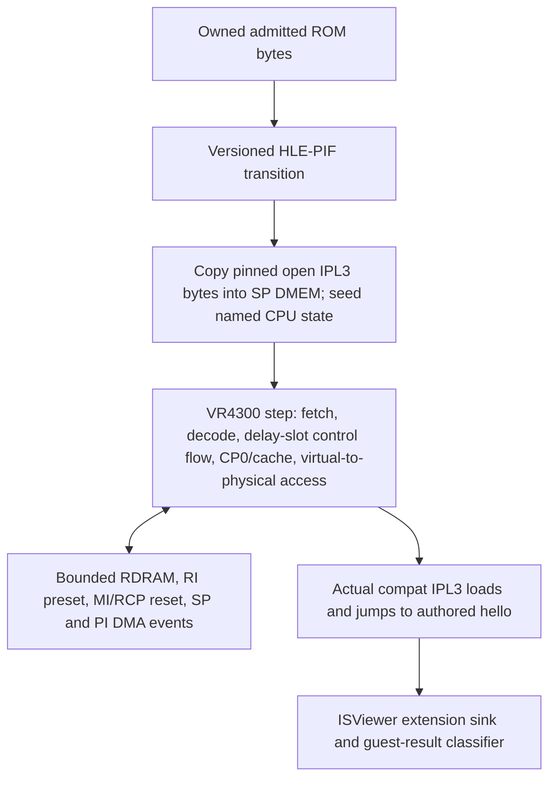

# Phase 3 Decision B — Post-IPL2 Contract and Minimum Execution Slice

**Status:** Recommendation for planning, conditional on Agent A's final IPL3 pin. This memo does not establish a hardware boot handoff or a broad CPU/RSP accuracy claim.

## Recommendation

Use the `r8-source compat` open IPL3 variant Agent A is evaluating, with a versioned **Tier-A prepared-RDRAM warm-entry profile** for Phase 3. HLE-PIF must copy and execute the selected IPL3 bytes; the guest CPU then runs that actual code through its hello handoff. Treat the prepared memory state, reset type, IPL3 identity, HLE seed version, CPU/cache policy, and resulting limits as profile identity. Keep true cold RDRAM register initialization for Phase 6.

This is the smallest route consistent with the roadmap's later Tier-A/Tier-B split. It proves that this named open IPL3 path and an authored hello execute under a deterministic model. It does **not** prove the machine reproduces a real console's exact post-IPL2 state or cold boot.

### Evidence boundary

- **Hardware-document fact:** Nintendo's §6.10 describes reset entering boot code in PIF ROM and lists aggregate boot-code work: CPU CP0 and RCP initialization, RDRAM/cache initialization, loading a 1 MiB program to physical `0x00000400`, and transfer through the game preamble. The manual does not allocate each operation to IPL1, IPL2, or IPL3 and does not give the register values at a custom IPL3 entry. Do not attribute that full sequence to PIF hardware alone. [Nintendo Programming Manual v5.2 §6.10](https://ultra64.ca/files/documentation/online-manuals/man-v5-2/allman52/pro-man/pro06/06-10.htm); exact retrieved bytes are indexed in [03-PRIMARY-EVIDENCE-INDEX.md](03-PRIMARY-EVIDENCE-INDEX.md).
- **Hardware-document fact:** The VR4300 manual describes the 32-bit kernel direct-mapped segments, CP0, branch/load delay behavior, and cache operation/state rules. KSEG0/KSEG1 do not need a TLB for the addresses this path uses; their translation/cache behavior still needs to be modeled or explicitly bounded. [NEC VR4300 User's Manual §§4.2–4.3, 5.2.4, 5.4.9, 11.3–11.5](https://hack64.net/docs/VR43XX.pdf). The manual also says cache initial state depends on the system; the HLE preset must not be presented as a hardware reset fact.
- **Software expectation:** At pinned libdragon source commit [`98154dafd5ac50e74ee09a5de1035d24a53f54f0`](https://github.com/n64brew/libdragon/tree/98154dafd5ac50e74ee09a5de1035d24a53f54f0/boot), the boot README defines IPL2 arguments in `$s3`–`$s7`: ROM type, TV type, reset type, seed, and version. For this route, source defines cartridge as `0`, NTSC as `1`, and warm reset as `1`; these are values expected by this open software path, not independently verified hardware handoff values. The compat code writes the version argument into boot information; no numeric seed value is established here. [`boot/README.md`](https://github.com/n64brew/libdragon/blob/98154dafd5ac50e74ee09a5de1035d24a53f54f0/boot/README.md), [`boot/ipl3.c`](https://github.com/n64brew/libdragon/blob/98154dafd5ac50e74ee09a5de1035d24a53f54f0/boot/ipl3.c).
- **Software expectation:** The compat build selects its warm path when `RI_SELECT` is nonzero; it probes memory size, clears RDRAM through SP DMA, loads its stage via PI DMA, resets a bounded set of RCP registers, and transfers to the ROM header entrypoint. Its linker targets VR4300 code in SP DMEM and later code in cartridge ROM. [`boot/rdram.c`](https://github.com/n64brew/libdragon/blob/98154dafd5ac50e74ee09a5de1035d24a53f54f0/boot/rdram.c), [`boot/loader_compat.c`](https://github.com/n64brew/libdragon/blob/98154dafd5ac50e74ee09a5de1035d24a53f54f0/boot/loader_compat.c), [`boot/minidragon.h`](https://github.com/n64brew/libdragon/blob/98154dafd5ac50e74ee09a5de1035d24a53f54f0/boot/minidragon.h), [`boot/ipl3_compat.ld`](https://github.com/n64brew/libdragon/blob/98154dafd5ac50e74ee09a5de1035d24a53f54f0/boot/ipl3_compat.ld).
- **Unknown:** The Nintendo manual retrieved here does not establish the exact CPU register/CP0 state after IPL2. The compat source does not establish what actual hardware returns for the out-of-profile memory probes or its RDRAM calibration. Do not fill these gaps with guessed hardware constants.

### Why the roadmap needs this explicit boundary

The selected compat source has two routes. With `RI_SELECT == 0`, it runs its cold RDRAM register/calibration path, which overlaps the current Phase 6 goal. With nonzero `RI_SELECT`, it takes its warm path and expects memory already configured. Use the latter as Phase 3's named Tier-A preset, then retain it as a regression when Phase 6 adds the Tier-B cold register protocol. That is a synthetic warm-entry claim, not authentic cold boot. If Phase 3 is required to claim cold-start entry, move the minimum RI/RDRAM protocol into Phase 3 and accept the larger scope; the model still needs explicit policy for analog/calibration details without hardware-derived vectors.

## Minimum execution seams

1. **HLE-PIF boundary (model policy):** Copy the pinned IPL3 payload from the owned normalized ROM into SP DMEM, start the VR4300 at its linked DMEM entry, and seed only the source-defined arguments needed by this profile. Keep `$s6`/seed numeric policy and version value explicit in profile/results; no value here is asserted as a hardware fact. The HLE transition bypasses original PIF bytes, CIC challenge/response, and authenticity checks.
2. **CPU execution:** Add a real bounded VR4300 instruction step before event dispatch is declared progress. The current `t64_machine_advance` delegates to the synthetic event scheduler; current instruction counters are synthetic-event counters, not CPU work ([`t64_machine.c:490-499`](../../../core/t64_machine.c), [`t64_scheduler.c:35-44`](../../../core/t64_scheduler.c), [`machine-contract.md:246-258`](../../../docs/spec/machine-contract.md)). Translate 32-bit kernel KSEG0/KSEG1 addresses before reaching the physical bus; keep the host debug bus explicitly physical ([`t64_machine.h:211-221`](../../../core/include/tendies64/t64_machine.h)).
3. **Minimum exact ISA work known from source:** VR4300 code uses ordinary integer/bitwise instructions, loads/stores, control transfers with architectural delay slots, `mfc0`/`mtc0` for Count/Cause/Compare/WatchLo/TagLo/TagHi, `CACHE` operations for index-tag and data-cache maintenance, and MIPS III `sdl`/`sdr` partial stores. The linked warm path also needs byte/word access and branch behavior. This is a source-level lower bound, **not a complete compiled opcode inventory**. `mips64-elf-gcc` and matching binutils are absent on the current machine, so the exact reachable list could not be verified. Make exact disassembly of the pinned artifact (or a reproducible build of it) a plan prerequisite; unsupported instructions must stop/classify as boot failure rather than act as no-ops.
4. **Bounded devices:** Keep 4 MiB RDRAM and existing PI/SP DMA event ordering. Add only the profile behavior this path consumes: `MI_VERSION`/`RI_SELECT` warm selection; deterministic 4 MiB capacity-probe behavior; the SP DMA zero-source case used to clear IMEM; SP status/PC/semaphore reset writes; MI interrupt/mask/mode clear writes; and the PI/SI/AI status-clear writes performed by `rcp_reset`. SI/AI are empty reset states here, not implemented peripherals. These are explicit model policies unless backed by a primary source or hardware-derived test.
5. **No RSP instruction execution:** The candidate boot is compiled for the VR4300 and executes CPU code from SP DMEM; it uses SP memories and DMA/registers as devices. It does not require the RSP scalar/vector instruction engine or graphics/audio microcode. Keep full RSP execution in Phase 5.
6. **Outputs:** ISViewer is an emulator/runner observation extension, not a Nintendo hardware result. Specify its buffer, length, and completion rules as project-owned protocol and verify with an authored hello. Timed input trace requirements can use scheduled observation events, but they do not imply guest-visible controller behavior in Phase 3.

Current machine gaps are concrete: profile boot status is still `unimplemented` ([`t64_machine.c:18-35`](../../../core/t64_machine.c)); physical RDRAM is supported only below 4 MiB and RI/SI/AI windows are unsupported ([`machine-contract.md:93-120`](../../../docs/spec/machine-contract.md)); SP DMA is modeled, while RSP instruction state is absent ([`t64_internal.h:120-157`](../../../core/t64_internal.h)). No broad CPU/cache/TLB support should be claimed from this slice.

## Acceptance and negative controls

- Run the exact fixture bytes the runner consumes, attested through the Phase 1 verified-descriptor/private-copy seam. Record IPL3 source revision and binary identity separately from the hello ROM identity.
- Observe nonzero real CPU instruction progress at the IPL3 entry, the compat loader's PI/SP DMA completions, the hello entry, and exact ISViewer text/length. The pass must depend on semantic guest output, not merely an image being admitted or a host-written result.
- Pin deterministic state/profile identity for the HLE seed version, reset type, Tier-A RDRAM preset, cache simplification, open IPL3 digest, and guest-time quantum. Include CPU/CP0/device guest state in canonical digests; do not count host wall time as guest time.
- Negative controls: no output, bad output/length, altered seed or entry address, unsupported opcode, invalid DMA source/destination, stale or missing fixture, guest timeout, and a runner that skips IPL3 must never classify as pass. Repeated Linux/GCC and macOS/Clang runs must have equal guest-state digests for the exact named profile.
- The project-authored hello's input trace proves scheduled trace events only. Controller/SI/PIF behavior remains unclaimed.

## Reversal evidence

Keep the Tier-A warm preset if the pinned compat artifact reaches hello with only the bounded behaviors above and the phase claim is “deterministic open-IPL3 warm-entry smoke.” Move cold RI/RDRAM initialization into Phase 3 only if the owner changes the required claim to cold boot, the selected artifact's exact entry path cannot run under the preset, or primary/hardware-derived evidence shows the warm route is invalid for the named test profile. Phase 6 should replace the synthetic preset only after its register/probe expectations are independently justified; matching another emulator or one screenshot is insufficient.
