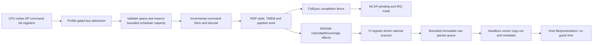

# Phase 7: RDP Reference Renderer and VI Scanout — Research

**Researched:** 2026-11-16  
**Domain:** Nintendo 64 RDP/VI reference implementation in a deterministic C17 machine  
**Confidence:** MEDIUM overall; HIGH for repository seams and the cited documented fields; MEDIUM/LOW for undocumented layout details and software timing policy.

<user_constraints>
## User Constraints (from CONTEXT.md)

### Locked Decisions

### Real consumer before expansion

- **D-01:** Lead with an authored CPU-written DP fill list through ordinary
  bus/DP dispatch, RDRAM, VI and the actual headless runner. Independently
  derive literal RDRAM pixels and raw-frame expectations. A wrong-pixel control
  reuses the successful setup and fails at the intended comparator. Record
  first differing address/coordinate, not only a final image hash. Run this
  cheap accepted path before long native/instrumented suites. It is a tracer,
  not completion of copy/triangle/combiner/blender/coverage/Z/filtering work.
- **D-02:** Stay with current C17/CMake/CTest and authored diagnostics. Add no
  renderer, codec, serialization dependency, cache or production concurrency
  without a concrete capability and measured need. Runtime commands execute
  in the background; existing rights/resource limits remain unchanged.

### DP command and completion ownership

- **D-03:** Keep DP registers, pointers, status, RDP/TMEM state, pending work
  and completion fences in the canonical machine. Use scheduler-owned
  incremental command processing, not complete synchronous rendering hidden
  inside an END register write. FullSync raises MI DP only after preceding
  modeled pipeline effects complete; CURRENT==END alone is insufficient.
  Exact tick costs/tie policies need a named sourced or software-model basis.
- **D-04:** Reserve bounded capacity before mutation. Register admission checks
  register/address/profile constraints; fetched commands validate their full
  required words before their own effects. Do not add a whole-list snapshot
  or scan merely to simplify validation without explaining observable effects.
  Refused admission preserves its defined state/digest/tick. An unsupported
  encountered opcode stops at that command, with no effects or synthetic
  completion from it; earlier accepted/completed commands remain committed.
  Keep busy/pending/completion distinct and test masks, DP clear and FullSync
  held behind earlier work. This stop policy is software behavior where
  unsupported-encoding hardware behavior is unknown.

### VI time, raw output and refusal effects

- **D-05:** Derive VI phase from canonical elapsed guest time using bounded
  exact rational phase/remainder, separate from CPU retirement and host time.
  Include future-affecting VI phase/pending events in machine state/digest.
  Source the selected TV constants and register latch/field behavior; name
  any unresolved timing choices as profile software policy. Preserve existing
  guest tick ownership; do not call each instruction a VI cycle.
- **D-06:** Use a bounded lossless raw packet queue and observer copy-out.
  Reserve complete output capacity before committing its producing boundary;
  output-full stops resumably with the producing event pending, without loss,
  overwrite or fabricated guest progress. Host drain/cursor/file writes do
  not advance guest time. Insufficient destination capacity reports required
  size without partial copy or cursor movement; invalid spans are refused.
  Test equal guest-boundary digests and byte-identical output across drain
  cadence, advance partitions and interleaved instances.
- **D-07:** Specify raw capture encoding and metadata explicitly (an initial
  RGBA8 software packet is suitable): actual geometry/stride, source pixel
  representation, field/parity, VI filter state, guest timing, sequence and
  profile/build identity. Keep RDRAM source bytes, VI scanout and host scaling
  distinct. No assumed320x240. Host cursors/output buffers stay outside the
  canonical digest; retain every guest-future-affecting device field. Detailed
  queue sizing and raw copy-out schema remain implementation discretion.

### Identity, evidence and rights

- **D-08:** Apply the already approved compatibility policy: preserve established
  semantics/identities where unchanged; version concrete changed composite
  behavior, descriptor/state layouts and policy fields as needed. No profile
  per device, version per fix, or additional compatibility promise. Keep the
  public C surface provisional through Phase9; Phase10 owns ABI freeze.
- **D-09:** Explicitly name deterministic noise/undefined-memory policies and
  bind their affected semantics to profile identity. Do not infer silicon
  behavior from stable output, secondary code, or an emulator comparison.
  Keep source facts, code observations, choices, measurements and unknowns
  distinct. Each remaining command class needs independent expected results.
- **D-10:** VID-04 remains blocked/incomplete. No Angrylion execution/copying/use
  or oracle-derived publication is authorized here. Parallel-rdp requires its
  per-file/asset audit. Authored pins cannot replace the required differential
  evidence. D2 external diagnostic assets/results remain local-only; D4/D6/D7
  and physical/paid/destructive stops persist without repeated confirmation.

### the agent's Discretion

Concrete internal layouts, bounded integer algorithms, safe queue limits,
profile/schema names and version numbers follow the approved policies and
primary evidence. Make the smallest verifying implementation promptly;
reopen a decision only for a concrete contradiction. No rights/risk acceptance
is delegated by routine implementation discretion.

### Deferred Ideas (OUT OF SCOPE)

GPU rendering, codecs, live preview loss policy, physical measurement, broad
compatibility, new media/regions, ABI freeze and native presentation stay in
later scope. Oracle-derived acceptance waits on its existing specific gates.
</user_constraints>

<phase_requirements>
## Phase Requirements

| ID | Description | Research support |
|---|---|---|
| VID-01 | An in-tree software RDP renders command lists (fill, copy, textured and shaded triangles, combiner, blender, coverage, Z) into RDRAM | Source command families, bus/scheduler integration and staged implementation order are documented below. The fill tracer is only the first slice; all listed classes remain required. |
| VID-02 | SYNC_FULL and the DP interrupt behave per the references | FullSync completion and MI DP register sources are identified; admission, pending work, mask/clear and completion-fence tests are recommended. |
| VID-03 | A software VI produces raw frames from RDRAM using the profile's TV timing, interlace, pixel format and filtering, never assuming 320×240 | VI register inventory, primary source locators, exact rational phase recommendation, raw packet boundary and unresolved latch/filter gaps are recorded. |
| VID-04 | RDP conformance is reported as differential evidence with labeled oracle versions (Angrylion-Plus and parallel-rdp used out-of-tree only), never as hardware truth | Specific acceptance remains blocked by unresolved D5 authority and parallel-rdp per-file/asset audit. No use, output copying, or oracle-derived pin is permitted by this phase context. |
| VID-05 | Undefined-behavior choices (noise seed, undefined memory color) are recorded as named policy choices | Record explicit deterministic policy names, profile binding and authored evidence; keep unknown hardware outcomes separate. |
| VID-06 | Raw video output stays separate from host scaling and filtering | Keep RDRAM, VI raw packet and host presentation/file writing at separate ownership boundaries; host drains do not advance guest time. |
</phase_requirements>

## Summary

Implement RDP and VI as devices inside the existing canonical machine, with scheduler-owned incremental work, explicit profile/state ownership and a bounded lossless raw output path. Start with one authored CPU-written fill command list accepted by the ordinary DP bus path, then prove RDRAM bytes, VI packet bytes and the actual headless runner independently. The success check and a same-setup wrong-pixel control must reach the pixel comparator; report the first differing RDRAM address or output coordinate. This is a narrow software-path check, not completion evidence for the remaining RDP classes or hardware accuracy. [CITED: Nintendo RDP programming overview](https://ultra64.ca/files/documentation/online-manuals/man-v5-1/pro-man/pro12/index.htm); [VERIFIED: 07-CONTEXT.md D-01]

Keep packet parsing and expected-value derivation separate: the six-bit raw RDP opcode field and a full GBI command byte are related encodings, not different operations when their lower six bits match. Preserve the fixture's original input words/bytes and bitfields alongside decoded fields. The SGI triangle summary disagrees with its detailed word tables, so triangle packet lengths must be independently resolved from primary bit layouts before implementation; this does not block the fill tracer. Use existing C17, CMake, CTest, scheduler, MI, digest and runner seams. No new renderer/codec/serialization dependency is recommended. VID-04 is still blocked; authored vectors cannot discharge it. [CITED: SGI RDP Command Summary v2.0](https://ultra64.ca/files/documentation/silicon/SGI_RDP_Command_Summary.pdf); [CITED: Nintendo `gbi.h`](https://ultra64.ca/files/documentation/online-manuals/man/header/gbi.htm); [VERIFIED: 07-CONTEXT.md D-10]

**Primary recommendation:** Plan a small first accepted DP fill → RDRAM → VI → real-runner slice, followed by staged command groups and VI timing/filter cases. Keep exact software timing costs named and profile-bound; do not claim hardware timing without a source or measurement. Resolve the triangle layout before adding those packets. Keep VID-04 visibly incomplete until both existing rights gates are cleared and actual differential work is authorized.

## Architectural Responsibility Map

| Capability | Primary tier | Secondary tier | Rationale |
|---|---|---|---|
| DP registers, command admission, RDP/TMEM state and raster effects | Canonical machine / RDP device | Bus and scheduler | Guest-visible state and command progress must remain deterministic and per-instance. |
| MI DP pending/mask/IRQ line | Canonical machine / MI | RDP completion event | MI already owns pending/mask and IRQ aggregation; RDP completion should signal MI only at its modeled fence. [VERIFIED: `core/t64_mi.c:17-42,62-89`] |
| VI phase, register latch, field and raw scanout | Canonical machine / VI device | Scheduler | Guest time determines scanout. Future-affecting phase belongs in machine state and digest. [VERIFIED: `core/t64_machine.c:17-63`; `07-CONTEXT.md` D-05] |
| Raw output buffering/copy-out | Machine guest output + host observer cursor | Runner | Guest-produced bytes are retained state; cursor and file writing are host responsibilities. [VERIFIED: `core/t64_internal.h:581-619`; `core/t64_digest.c:375-390`] |
| Host scaling, display, files | Runner/host | — | Kept outside RDRAM, VI output and machine guest time. |

## Project Constraints (from AGENTS.md)

- Keep one canonical deterministic machine separate from host clocks, files, physical input mapping, presentation and durable storage; define content/profile/input/time/output/lifecycle/error ownership and refusal effects before promising API/ABI. [VERIFIED: `AGENTS.md:24-27`]
- Preserve observable RDP/VI and memory boundaries and separate guest progress/time, raw video and host presentation. [VERIFIED: `AGENTS.md:28-30`]
- Keep dependencies flat; add none without a concrete capability and justified lifetime/supply-chain cost. [VERIFIED: `AGENTS.md:31-34`]
- Treat manuals, diagnostic assets and parsers as rights-bearing or untrusted. Do not commit, use in public CI or redistribute protected material without documented permission; a hash is not rights clearance. [VERIFIED: `AGENTS.md:35-38`]
- Bind support statements to exact profile, build and evidence tier. A screenshot, test score, hash or emulator agreement alone is not broad compatibility or hardware-accuracy evidence. [VERIFIED: `AGENTS.md:39-42`]
- Keep owner stops and evidence provenance intact; distinguish source facts, code observations, inference, policy, measurements and unknowns. [VERIFIED: `AGENTS.md:53-58,68-73`; `07-CONTEXT.md` D-10]

## Standard Stack

### Core

| Component | Version/constraint | Purpose | Recommendation |
|---|---|---|---|
| C | C17, extensions off | Deterministic core devices and integer raster/scanout | Continue current core language and warnings policy. `CMakeLists.txt` contains `set(CMAKE_C_STANDARD 17)`, `set(CMAKE_C_STANDARD_REQUIRED ON)`, `set(CMAKE_C_EXTENSIONS OFF)`. [VERIFIED: `CMakeLists.txt:1-6`] |
| CMake + CTest | Repository requires CMake 3.25 minimum; existing test registration | Build, focused tests and phase suite | Reuse current project targets and CTest registration. [VERIFIED: `CMakeLists.txt:1-12`] |
| Existing in-tree test harness | `unit.core.*`, integration and control test naming | Authored independent behavior pins and real-consumer checks | Extend current test targets; keep production core free of host/test code. `core/CMakeLists.txt` registers `unit.core.tracer` and `unit.core.boot-entry` as `LABELS unit`. [VERIFIED: `core/CMakeLists.txt:1-3,157-177`] |
| Existing build identity and digest helpers | Current repository implementation | Bind build/profile and canonical guest state | Extend existing explicit identity/digest paths for changed future-affecting RDP/VI state only. [VERIFIED: `core/CMakeLists.txt:16-66`; `core/t64_digest.c:375-390`] |

**Dependencies:** No external package or new dependency is recommended. Do not use a host GPU renderer, image codec, third-party serializer or OS presentation API for this phase. No Package Legitimacy Audit is applicable because the phase adds no packages.

**Environment observed (not built):** CMake 4.4.3, Ninja 1.13.2 and Apple clang 21.0.0 are available. These are tool availability observations only; no configure, build or test was run. [VERIFIED: shell version probes, 2026-11-16]

## Architecture Patterns

### Data flow

The diagram describes recommended ownership and ordering, not a claim that this pipeline exists today. Current code has DP and VI address windows in unsupported bus decode and RSP DP register access records a refusal. Exact source quotes: `if ((address >= T64_DP_BASE && address < T64_MI_BASE) || (address >= T64_VI_BASE && address < T64_VI_BASE + T64_DEVICE_WINDOW_BYTES) || (address >= T64_PIF_BASE && address < T64_PIF_END)) { return T64_BUS_REGION_UNSUPPORTED; }` [VERIFIED: `core/t64_bus.c:145-150`]; `machine->rsp_observed_refusal_reason = T64_RSP_REFUSAL_DP_UNAVAILABLE;` [VERIFIED: `core/t64_rsp.c:1822-1823`]. These are current implementation observations, not hardware facts.

### Recommended project responsibility map

Keep the device state in existing core ownership: `core/t64_internal.h` machine state, new internal DP/RDP and VI state modules, `core/t64_bus.c` register routing, `core/t64_scheduler.c` incremental events, `core/t64_mi.c` interrupt line, `core/t64_digest.c` semantic state, public machine header only for required raw-output contract, and the real headless runner/fixture path for authored end-to-end acceptance. Exact module names are planning recommendations, not established paths. Existing runner targets are `t64-runner-real` and `t64-runner-test`; source says the former “consumes verified inherited snapshots” and emits a result record, so Phase 7 needs a new authored fixture integration rather than treating current result capture as video output. [VERIFIED: `runner/CMakeLists.txt:258-273`]

## Primary RDP and VI Facts Needed for Planning

### Command encoding and raw packet boundaries

| Item | Source-backed fact | Planning consequence |
|---|---|---|
| Direct RDP command field | SGI's command field occupies bits 61–56 (six bits). Nintendo `gbi.h` documents that hardware checks the lower six bits of the command byte. [CITED: [SGI RDP Command Summary v2.0](https://ultra64.ca/files/documentation/silicon/SGI_RDP_Command_Summary.pdf), pp. 2, 41-42; [Nintendo `gbi.h`](https://ultra64.ca/files/documentation/online-manuals/man/header/gbi.htm), command definitions/comment around lines 81–84] | Keep full incoming command word/byte intact for tests and diagnostics; use lower-six-bit field for direct RDP operation dispatch. Do not normalize fixture bytes before assertions. |
| GBI versus raw RDP | Nintendo `gbi.h` gives full GBI IDs such as `G_SETFILLCOLOR 0xF7`, `G_FILLRECT 0xF6`, and `G_RDPFULLSYNC 0xE9`; lower-six-bit decoding yields the same direct RDP operations as raw command-field values `0x37`, `0x36`, and `0x29`. They are encodings at different layers, not distinct decoded operations. [CITED: [Nintendo `gbi.h`](https://ultra64.ca/files/documentation/online-manuals/man/header/gbi.htm); [SGI RDP Command Summary v2.0](https://ultra64.ca/files/documentation/silicon/SGI_RDP_Command_Summary.pdf)] | Distinguish full byte from field in names/logging. A parser test should retain original word and assert parsed raw field separately. |
| Fill tracer command group | Direct raw RDP `Set Color Image` is `0x3F`, `Set Scissor` `0x2D`, `Set Other Modes` `0x2F`, `Set Fill Color` `0x37`, `Fill Rectangle` `0x36`, and `Sync Full` `0x29`; each is one 64-bit direct RDP word. The fill rectangle stores XL/YL/XH/YH as 10.2 coordinates. [CITED: [SGI RDP Command Summary v2.0](https://ultra64.ca/files/documentation/silicon/SGI_RDP_Command_Summary.pdf), pp. 2, 21, 27–29, 34, 36, 41; [Nintendo `gbi.h`](https://ultra64.ca/files/documentation/online-manuals/man/header/gbi.htm)] | This command group is a bounded first acceptance path. Store original 64-bit fixture words and a separately documented field breakdown. Do not bake an assumed rectangle endpoint convention into expected pixels without source check. |
| FullSync | Raw direct opcode `0x29`, one 64-bit word. SGI says it waits for preceding primitive buffers to be read/written. Nintendo describes it as the final command and says the DP event follows completion of the last pipeline command. [CITED: [SGI RDP Command Summary v2.0](https://ultra64.ca/files/documentation/silicon/SGI_RDP_Command_Summary.pdf), p. 41; [Nintendo RDP synchronization §12.2](https://ultra64.ca/files/documentation/online-manuals/man-v5-2/allman52/pro-man/pro12/12-02.htm); [Nintendo `gDPFullSync`](https://ultra64.ca/files/documentation/online-manuals/man-v5-1/n64man/gdp/gDPFullSync.htm)] | Model a completion fence after earlier pipeline effects. Reaching DPC_END/CURRENT==END is not sufficient to raise MI DP. Keep command fetch, RDP work and completion separately observable. |
| Texture rectangle | Direct RDP texture rectangle is 128 bits (two 64-bit words); the Nintendo GBI macro expands into a texture-rectangle command plus RDPHALF data commands. [CITED: [Nintendo `gbi.h`](https://ultra64.ca/files/documentation/online-manuals/man/header/gbi.htm), texture rectangle structures and `gsDPTextureRectangle`; [SGI RDP Command Summary v2.0](https://ultra64.ca/files/documentation/silicon/SGI_RDP_Command_Summary.pdf), pp. 22–24] | Keep raw DP parser scope distinct from upstream GBI-list parsing; command-length accounting belongs to the direct RDP packet format unless a separate RSP/GBI path is explicitly added. |
| Triangle command family | SGI lists direct raw triangle opcodes `0x08`–`0x0F`, with edge, shade, texture and Z word groups. Its summary table conflicts with the detailed coefficient word layout, and the Z table contains an inconsistent final word label. [CITED: [SGI RDP Command Summary v2.0](https://ultra64.ca/files/documentation/silicon/SGI_RDP_Command_Summary.pdf), pp. 12–20] | Before triangle implementation or expected-vector construction, cross-check per-opcode word count and bit layout against an independent primary layout source. Keep the current exact length/layout unresolved; do not copy the summary table's group counts or infer from a secondary emulator. This is a planning task, not a blocker to fill. |
| LoadSync source discrepancy | SGI summary labels Sync Load `0x31`, while Nintendo `gbi.h` defines full-byte `G_RDPLOADSYNC 0xE6` and documents low-six-bit command handling (raw direct field `0x26`). [CITED: [SGI RDP Command Summary v2.0](https://ultra64.ca/files/documentation/silicon/SGI_RDP_Command_Summary.pdf), p. 42; [Nintendo `gbi.h`](https://ultra64.ca/files/documentation/online-manuals/man/header/gbi.htm)] | Record as source discrepancy and use the cross-checked Nintendo command encoding for planning; verify actual primary source pages before implementing. Don't generalize this correction to other commands without cross-check. |

SGI PDF locator retained only under ignored `build/research/07-primary/SGI_RDP_Command_Summary.pdf`; SHA-256 observed as `fe019ef28498d759292145f06716ac11620240e643dd65809d15ca4a6f1c6ad3`. It is a research locator, not permission to redistribute the manual. `.gitignore` contains `build/`. [VERIFIED: `.gitignore:1-2`; local SHA-256 command, 2026-11-16]

### Primary DP, MI and VI register sources

Nintendo SDK `rcp.h` revision 1.21 (1998-07-31) is the source for the register values below; these are document definitions, not values inferred from emulator source. [CITED: [Nintendo SDK `rcp.h`](https://ultra64.ca/files/documentation/online-manuals/man/header/rcp.htm), “DP Command Registers,” “MI Interrupt Registers,” “VI Registers”]

| Block | Register/field inventory | Plan use |
|---|---|---|
| DPC | Base `0x04100000`; START `+0x00`, END `+0x04`, CURRENT `+0x08`, STATUS `+0x0C`; START/END address bits are 23:0. Status includes XBUS, freeze, flush, clock, TMEM, pipe, command, cbuf-ready and DMA busy/valid state; write commands clear/set XBUS, freeze, flush and clear status counters. | Implement documented access width, read/write masks, pointer advancement, busy/valid distinction and named software refusal. Validate span/alignment and complete packet before each packet's effects. |
| MI DP | `MI_INTR_DP` is `0x20`; interrupt-mask set/clear command encodings for DP are `0x0800`/`0x0400`. | Reuse current MI pending/mask/IRQ-line owner; test masked pending, mask transition, clear and one completion notification. |
| VI core | Base `0x04400000`; STATUS `+0`, ORIGIN `+4`, WIDTH `+8`, INTR `+0xC`, CURRENT `+0x10`, BURST `+0x14`, V_SYNC `+0x18`, H_SYNC `+0x1C`, LEAP `+0x20`, H_START `+0x24`, V_START `+0x28`, V_BURST `+0x2C`, X_SCALE `+0x30`, Y_SCALE `+0x34`. | Build exact register inventory tests. Derive geometry from width, origin, start and scale fields; never substitute a fixed frame size. |
| VI status and field | STATUS describes source pixel type (16/32 bit), gamma/dither, divot, serrate, AA and dither-filter controls. CURRENT reads half-line position and field; writing it clears VI interrupt. INTR uses half-lines; V_SYNC is half-lines per field. | Exercise field/parity and status bits independently. Exact write-latch and scanline timing remain unresolved until sourced; don't treat a register write as immediate physical latch without evidence. |
| VI clocks | SDK header constants: `VI_NTSC_CLOCK 48681812`, `VI_PAL_CLOCK 49656530`, `VI_MPAL_CLOCK 48628316`. [CITED: [Nintendo SDK `rcp.h`](https://ultra64.ca/files/documentation/online-manuals/man/header/rcp.htm), “VI clock rate”] | Use the selected profile TV constant as a sourced input to rational phase. It does not by itself define conversion from Tendies64's model-rsp-cycle tick or prove accurate line timing. |

The Nintendo VI chapter describes TV signal timing, active display, interlace, source pixel widths and filtering. NTSC/PAL/MPAL standard line/field descriptions are useful source constraints but are not proof of the exact profile's latch phase. VI descriptions also say register settings are typically updated around VBlank at manager level; exact MMIO latch point for this implementation remains open. [CITED: [Nintendo VI chapter](https://jrra.zone/n64/doc/pro-man/pro30/30-01.htm)]

### Rendering pipeline facts and staged coverage

The Nintendo RDP manual describes logical rasterizer, texture/TMEM, filter, combiner, blender and memory-interface stages. It documents 4 KiB TMEM and eight tile descriptors, point/box/bilerp filter choices (with hardware interpolation behavior more specific than a generic four-sample bilinear), the combiner equation `(A-B)*C+D`, fill/copy modes, and coverage/alpha/depth participation in blending. [CITED: [Nintendo RDP Programming §12](https://ultra64.ca/files/documentation/online-manuals/man-v5-1/pro-man/pro12/index.htm); [§12.1–12.8](https://ultra64.ca/files/documentation/online-manuals/man-v5-2/allman52/pro-man/pro12/12-01.htm)]

Plan implementation as successive, independently accepted slices rather than one giant command tracer:

1. **DP fill tracer:** register admission and one-command processing, fill writes to 32-bit test color image, RDRAM bytes and one raw VI packet via the actual real runner; independent literal expectations and wrong-pixel comparator control.
2. **Completion and copy path:** separate command fetch from pipeline effect; FullSync fence/MI behavior; copy mode and TMEM load/read state with source-derived formats and bounded per-command validation.
3. **Triangle rasterization:** first edge-only coverage/clip cases, then shaded, textured and Z attribute groups after packet layout is independently reconciled. Keep edge, shade, texture, Z and coverage effects separately observable.
4. **Combiner and blender:** add cycle mode/source selection and render modes; each has independent expected pixels and control cases for alpha/coverage/depth interactions.
5. **VI expansion:** register inventory, multiple non-320×240 geometries, 16/32-bit source pixels, field/parity and each filtering/gamma/divot/dither behavior in bounded cases.
6. **Undefined policies and acceptance inventory:** name deterministic noise and undefined-memory color policies, bind only changed semantics to the approved composite profile/version fields, and maintain exact command-class case inventory. Keep the VID-04 differential item blocked.

Ordering beyond sourced synchronization is software policy. Do not derive or claim DP cost per command/pixel, VI tick conversion, bus contention or same-tick tie behavior from the source code. The current event comparator orders events by tick then sequence; its source is `return left->tick < right->tick || (left->tick == right->tick && left->sequence < right->sequence);`. [VERIFIED: `core/t64_scheduler.c:10-13`] Keep the model named in profile policy and ensure future-affecting queued work/time phase is included in semantic digest.

## First Slice: Executable Acceptance Recommendation

Implement a bounded, rights-cleared authored fixture that writes the documented single-word direct RDP commands through CPU-visible DP registers. The initial word sequence should establish color image/format/width, scissor, fill cycle mode and fill color; issue one Fill Rectangle; then FullSync. Use the same actual `t64-runner-real` process/fixture ownership path that Phase 7 extends, not a renderer-only helper. Select a small nonzero visible region fully inside the configured scissor and active VI window, plus a 32-bit source mode so each expected RDRAM pixel can be stated in byte order. Preserve each original 64-bit command word and annotate every decoded bitfield. Exact rectangle endpoint/rounding and fill byte order must be confirmed from the primary command tables when authoring literals; do not guess these details from a stable implementation. [CITED: SGI command table and Nintendo VI/RDP sources linked above; VERIFIED runner targets `runner/CMakeLists.txt:258-273`]

Acceptance sequence:

1. Assert fixture admission and semantic progress show DP accepted the commands and retired the expected Fill Rectangle/FullSync sequence through ordinary bus dispatch.
2. Compare literal RDRAM bytes at independently calculated addresses before VI conversion; report first differing address, expected bytes and actual bytes.
3. Compare raw VI packet metadata and independently calculated pixel bytes before any host scaling/filtering; report first differing `(x,y,field)` coordinate and bytes. Keep the RDRAM and VI assertions separate so a packer/stride issue cannot hide an RDP write issue.
4. Repeat the same setup, changing only one expected pixel literal. Require the accepted trace to reach the intended pixel comparator and fail there. The test must not fail at fixture setup, rights, command admission, timeout or image hash.
5. Then test FullSync behind earlier modeled pipeline work, MI DP pending/mask/clear, and `CURRENT==END` without completion. This verifies fences without making a guessed cycle-accuracy claim.

This gives the planner a first deliverable that can begin without the unresolved triangle layout or VID-04 gate. It is only one authored software-path result and cannot close remaining VID-01 command classes, VI filtering/interlace coverage, or VID-04. [VERIFIED: `07-CONTEXT.md` D-01, D-03, D-10; [CITED: Nintendo FullSync reference](https://ultra64.ca/files/documentation/online-manuals/man-v5-1/n64man/gdp/gDPFullSync.htm)]

## Common Pitfalls

1. **Mixing GBI and raw RDP encodings.** A full GBI byte and direct six-bit RDP field are different representations. Keep original words and a separate decoded field; `0xF7` vs `0x37` does not mean different Set Fill Color operations. [CITED: Nintendo `gbi.h`; SGI command summary]
2. **Guessing variable command length.** The SGI triangle summary conflicts with its coefficient word tables, and one Z word label is inconsistent. Resolve layouts from primary source bit diagrams before constructing a packet decoder. [CITED: SGI command summary pp. 12–20]
3. **Treating END as completion.** The documented FullSync event follows pipeline completion; `CURRENT==END` only describes list/fetch progress. Separate busy, command retirement, pipeline fence and MI signal. [CITED: Nintendo RDP synchronization and `gDPFullSync`]
4. **Synchronous work hidden in register writes.** Rendering the whole list on END would hide progressive pointers, guest-time interleaving, queue pressure and the boundary FullSync must observe. Use scheduler-owned incremental operations; event costs are explicitly software timing unless sourced. [VERIFIED: `07-CONTEXT.md` D-03; `core/t64_scheduler.c:10-13,88-127`]
5. **Out-of-bounds and partial packet effects.** Validate address arithmetic, spans, alignment and the full packet length before effects from that command. Reserve bounded event/output capacity before mutating latches; define refusal and unsupported-opcode postconditions. [VERIFIED: `07-CONTEXT.md` D-04; current reservation returns `T64_STATUS_QUEUE_FULL` when full, `core/t64_scheduler.c:88-127`]
6. **Assuming coverage lives in ordinary RDRAM bytes.** Nintendo's memory description notes extra coverage/depth information in memory-system behavior; current machine has a `uint8_t *ram` plus separate device fields but no observed RDP coverage sidecar. Exact mapping is unresolved; decide an owned representation from primary material and include future-affecting state in digest. Do not infer hidden-bit packing. [CITED: Nintendo RDP Programming §12.8; VERIFIED: `core/t64_internal.h:581-603`]
7. **Fixed geometry and CPU-driven video.** VI width, origin, active window, scales, TV mode and field all matter. The profile tick unit currently contains `"model-rsp-cycle"`, not VI cycles; derive phase from elapsed guest time with exact rational remainder and named mapping. [VERIFIED: `core/t64_machine.c:31`; CITED: Nintendo `rcp.h` and VI chapter]
8. **Lossy or host-paced output.** Do not overwrite, drop or regenerate output based on host drain. Reserve one complete output packet at its producing boundary; a full queue must preserve that event as resumable with no fabricated guest progress. Host cursor is outside digest while guest future output state is inside. [VERIFIED: `07-CONTEXT.md` D-06; `core/t64_internal.h:602-603`; `core/t64_digest.c:375-390`]
9. **Overclaiming deterministic policy.** Stable noise, RAM color or output bytes are policy choices, not measured silicon. Name them, bind affected behavior to profile identity, and keep policy pins separate from source facts and hardware claims. [VERIFIED: `07-CONTEXT.md` D-09; AGENTS.md:68-73]
10. **Turning authored pins into differential acceptance.** Authored vectors establish only the exact software cases reached. VID-04 remains blocked while D5 authority and parallel-rdp per-file/asset audit remain unresolved; don't run/copy oracle material or claim their outputs. [VERIFIED: `07-CONTEXT.md` D-10; REQUIREMENTS.md Evidence and authority limits]

## Don't Hand-Roll

| Problem | Avoid | Use instead | Reason |
|---|---|---|---|
| Event order, bounded admission, same-tick tie | New private RDP event queue or synchronous loop | Existing canonical `(tick, sequence)` scheduler reserve/commit contract | Preserves one machine time order and tested reservation shape. [VERIFIED: `core/t64_scheduler.c:10-13,88-127,149-189`] |
| MI line and masks | RDP-owned duplicate interrupt state | Existing `t64_mi_set_pending`, clear and mask ownership | DP is one source in existing MI aggregation. [VERIFIED: `core/t64_mi.c:17-42,45-89`] |
| Canonical digest | Hashing host packet cursor or ad hoc renderer bytes only | Extend explicit digest/state serialization with future-affecting RDP/VI values; exclude host drain cursor | Maintains replay/digest domain contract. [VERIFIED: `core/t64_digest.c:375-390`; `07-CONTEXT.md` D-05–07] |
| Raw host presentation/encoding | GPU, SDL/window, image codec or implicit scaling in VI | Raw packet in core; runner owns file and host presentation | Requirement VID-06 keeps scanout separate from host transforms. |
| Crypto primitives | New hand-coded hash | Existing build/digest helpers | No new crypto need is introduced. [VERIFIED: `core/CMakeLists.txt:16-66`; `core/t64_digest.c`] |

## Validation Architecture

Validation is enabled: `.planning/config.json` contains `"nyquist_validation": true`, `"security_enforcement": true`, `"security_asvs_level": 1`, and `"security_block_on": "high"`. [VERIFIED: `.planning/config.json:8-23`]

### Test framework and commands

| Property | Value |
|---|---|
| Framework | Existing CMake + CTest harness; C17 core. [VERIFIED: `CMakeLists.txt:1-12`] |
| Config | Root `CMakeLists.txt`, core registrations in `core/CMakeLists.txt`, runner registrations in `runner/CMakeLists.txt`. |
| Focused test command | After a plan creates/configures the build: `ctest --test-dir build/gate --no-tests=error -R '^unit\.core\.(rdp|vi|dp)' --output-on-failure` (test names are recommendations; register exact names and exact cases in CMake before relying on this filter). |
| Full phase command | `./scripts/gate.sh`; run only after short accepted/refusal checks and source-seal checks pass. |
| Test execution status | No build or test was run during this research. |

### Phase requirements → verification map

| Req | Behavior to verify | Fast/expensive validation | Coverage is new? |
|---|---|---|---|
| VID-01 | Fill, copy, textured/shaded triangles, combiner, blender, coverage and Z write expected RDRAM effects | Fast exact authored case per class; literal expected bytes/pixels from source fields. Full phase native/instrumented cases after all classes register. | Yes; first fill fixture and all remaining classes. |
| VID-02 | FullSync fence waits for all earlier modeled pipeline work, DP pending/mask/clear follows MI rules | Fast negative: hold earlier work pending and prove no DP interrupt until fence; test masked pending and clear. Full scheduled ordering matrix later. | New DP/MI integration. |
| VID-03 | VI raw packet follows selected TV mode, field, source format and filter registers with actual geometry | Fast non-320×240 fill fixture + register/readback inventory; later per-field/per-filter authored literals, partition equivalence and independent dimensions. | Yes; VI path is not currently exposed as raw video. |
| VID-04 | Labeled out-of-tree differential evidence, never hardware truth | **Blocked acceptance.** Do not use/copy oracle artifacts or claim completion before D5 authority and parallel-rdp per-file/asset audit resolve. Later evidence must name exact version/build and remain distinct from hardware evidence. | Blocked, not replaceable by authored tests. |
| VID-05 | Named deterministic noise and undefined-memory color policies | Fast deterministic repeat/refusal checks across fresh/interleaved machine instances; ensure policy value and version appear in profile identity. | Yes. |
| VID-06 | Raw output remains separate from host scaling/filtering | Fast compare raw bytes/metadata at queue/copy-out; host drain cadence must not change guest tick/digest/bytes. | Yes. |

### Fast checks before expensive suites

1. Require exact registered case inventory and command-class denominator. A filtered/empty CTest selection or helper-only call is not acceptance.
2. Run first accepted real-runner fill path and reached one-literal wrong-pixel control. Assert semantic command progress, separate RDRAM and VI comparisons, first difference diagnostics and frame metadata.
3. Add fast negative/refusal cases before long runs: invalid DP span/alignment; command crossing RDRAM boundary; truncated multiword packet; unsupported opcode; event queue full; output queue full; bad VI output destination span. For each case, assert contract-specific unchanged digest/tick/registers/RDRAM/MI and no fabricated completion/output.
4. Test DP command-original-word preservation/decoded field, full-vs-split guest advancement equivalence, output drain cadence independence, interleaved machines, and same-tick scheduler ordering.
5. After each production edit, rerun cheap source/body/composition seals and provenance/fixture ownership checks; make sure new core source cannot be silently omitted from build identity or bypass normal bus/runner dispatch.
6. Only after these pass, run full native/unit/instrumented/hosted owner checks. None of these checks have been run as part of this research.

## Security Domain

| ASVS category | Applies | Control for this phase |
|---|---|---|
| V2 Authentication | No | No network or user authentication surface is introduced. |
| V3 Session Management | No | No session/cookie state is introduced. |
| V4 Access Control | Limited | Keep state per machine instance; no global RDP/VI buffers or cross-instance pointers. |
| V5 Input Validation | Yes | Validate register addresses, widths, alignment, 64-bit command words, packet length, RDRAM/TMEM span arithmetic, destination span and queue capacity before mutation. Reject overflow with defined postconditions. |
| V6 Cryptography | No new cryptography | Continue existing build/state digest utilities; do not implement crypto or treat a digest as evidence of rights. |

| Threat | STRIDE | Mitigation |
|---|---|---|
| Malformed/untrusted DP pointers and span wrap | Tampering, denial of service | Checked arithmetic before `start+length`; enforce RDRAM address window/alignment and complete-word availability before per-command effects. |
| Truncated/oversized/multiword packet | Tampering | Determine command length from verified raw packet layout; validate full command before effects; keep source discrepancy (triangle layout) as a gate before implementing those commands. |
| Malformed texture coordinates/TMEM addressing or large raster extents | Denial of service, memory corruption | Bound pixel loops and coordinate products with overflow checks; bound work per scheduler event; check TMEM reads/writes and output size before dispatch. |
| Scheduler/output saturation | Denial of service | Reserve event/packet capacity before mutation; define resumable queue-full stop without dropping data or progressing guest time. |
| Cross-instance/global renderer state | Information disclosure, tampering | Store all semantic RDP/VI/TMEM state per machine; include future-affecting values in digest and test interleaved instances. |
| Protected fixture/oracle-derived output enters repo or CI | Rights/policy breach | Authored rights-cleared fixture only; keep primary manuals as references and ignored local locator only; no oracle use/outputs while gates unresolved. |

## Open Questions and Explicit Gaps

1. **Triangle packet layout:** SGI summary counts conflict with detailed word diagrams, and a Z table field label is inconsistent. Which exact primary source layout governs each `0x08`–`0x0F` packet, and what is each full word count? Plan an independent primary-source reconciliation before implementing triangle decoding. No need to delay first fill.
2. **Video time mapping:** SDK clock constants exist, but no source establishes mapping from the current `model-rsp-cycle` profile tick to VI subcycles, phase origin, per-event cost or tie ordering. Keep a named software mapping and exact rational remainder; do not label it hardware timing. [VERIFIED: `core/t64_machine.c:31`; CITED: SDK `rcp.h`]
3. **VI register latch / field behavior:** Need source-backed active-window and interlace field/latch semantics for the target profile. Existing docs identify half-line fields and typical VBlank updates but don't settle all MMIO write latch boundaries.
4. **Coverage/depth hidden state:** Source documents additional memory-interface coverage/depth information, but its exact mapping into the existing byte RDRAM and a deterministic RDP sidecar isn't resolved. Do not guess packing or omit state that affects future output.
5. **RDP work costs and same-tick device order:** Primary references establish synchronization semantics but not Tendies64 scheduler event costs. Those costs/ties are explicitly named software model policy unless separately sourced.
6. **Raw packet schema and queue limits:** D-06/D-07 leave internal queue size and public copy-out schema to implementation discretion. Use bounded exact sizing, capacity-before-effect, per-packet metadata, host-only cursor and digest separation. Avoid API/ABI freeze.
7. **VID-04:** Blocked acceptance remains: D5 authority unresolved and parallel-rdp per-file/asset audit incomplete. No authorized oracle path currently exists. A future gate review must authorize that separate work; this research does not ask an owner question or accept rights risk.

## Assumptions Log

| # | Assumption or unresolved item | Risk if wrong | Handling |
|---|---|---|---|
| A1 | Exact fill rectangle endpoint/rounding, byte order and 32-bit fill expansion must be independently confirmed before fixing the first pixel literals. [ASSUMED: no exact vector was derived here] | Incorrect expected pixels could self-confirm an incorrect renderer. | Assign a short primary-table check before the first accepted fixture; retain command words and field annotations. |
| A2 | A bounded software profile policy can choose scheduler tick costs and VI rational tick mapping without claiming hardware-accurate timing. [ASSUMED: implementation feasibility] | A coarse model could fail required observable ordering or force a profile compatibility change. | Preserve concrete profile/state version rules and verify split/whole advance equivalence; report any material contradiction before broad implementation. |

## Sources

### Primary references

- [SGI, *Nintendo Ultra64 RDP Command Summary*, v2.0](https://ultra64.ca/files/documentation/silicon/SGI_RDP_Command_Summary.pdf) — direct RDP command fields, fill/texture/triangle/combiner/blender/sync descriptions; source inconsistencies are recorded above.
- [Nintendo SDK `rcp.h`, rev. 1.21 (1998-07-31)](https://ultra64.ca/files/documentation/online-manuals/man/header/rcp.htm) — DPC, MI DP and VI register addresses/fields and TV clock constants.
- [Nintendo SDK `gbi.h`](https://ultra64.ca/files/documentation/online-manuals/man/header/gbi.htm) — full GBI command bytes, lower-six-bit handling, generated raw RDP commands and texture rectangle expansion.
- [Nintendo RDP Programming chapter](https://ultra64.ca/files/documentation/online-manuals/man-v5-1/pro-man/pro12/index.htm) — pipeline blocks and sections on rasterizer, TMEM, filter, combiner, blender, memory interface and synchronization.
- [Nintendo RDP synchronization §12.2](https://ultra64.ca/files/documentation/online-manuals/man-v5-2/allman52/pro-man/pro12/12-02.htm) and [`gDPFullSync`](https://ultra64.ca/files/documentation/online-manuals/man-v5-1/n64man/gdp/gDPFullSync.htm) — FullSync and DP event semantics.
- [Nintendo VI chapter](https://jrra.zone/n64/doc/pro-man/pro30/30-01.htm) — signal timing, active window, interlace, field and filtering descriptions.

### Project sources inspected

- `.planning/phases/07-rdp-reference-renderer-and-vi-scanout/07-CONTEXT.md`, `07-COMMAND-OPTIONS.md`, `07-OUTPUT-OPTIONS.md`, `07-ADVERSARIAL-CHECK.md` — locked decisions, command/output source locators and adversarial acceptance checks.
- `.planning/REQUIREMENTS.md`, `.planning/STATE.md`, `.planning/research/SUMMARY.md`, `.planning/config.json`, `.planning/AUTONOMY.md`, `AGENTS.md` — phase requirements, current blocker, scope and project policy.
- `core/t64_bus.c`, `core/t64_rsp.c`, `core/t64_internal.h`, `core/t64_scheduler.c`, `core/t64_mi.c`, `core/t64_machine.c`, `core/t64_digest.c`, `CMakeLists.txt`, `core/CMakeLists.txt`, `runner/CMakeLists.txt`, `.gitignore` — current code/test/runner seams. Source observations establish current Tendies64 state only, not hardware facts.

## Metadata

**Confidence breakdown:**
- Stack and project seams: HIGH; CMake/test/runner and source files were opened, but no build/test was run.
- Command/register facts: MEDIUM to HIGH; linked primary references were checked, with explicit source conflicts retained as gaps.
- RDP/VI timing and hidden coverage mapping: LOW; not pinned by the reviewed references and not experimentally measured.
- Implementation sequencing: MEDIUM; recommendation follows owner-locked scope and the existing scheduler/runner boundaries.

**Research date:** 2026-11-16  
**Valid until:** 2027-02-16 for the stable primary manual and current-code observations; recheck repository seams at planning/execution time.
